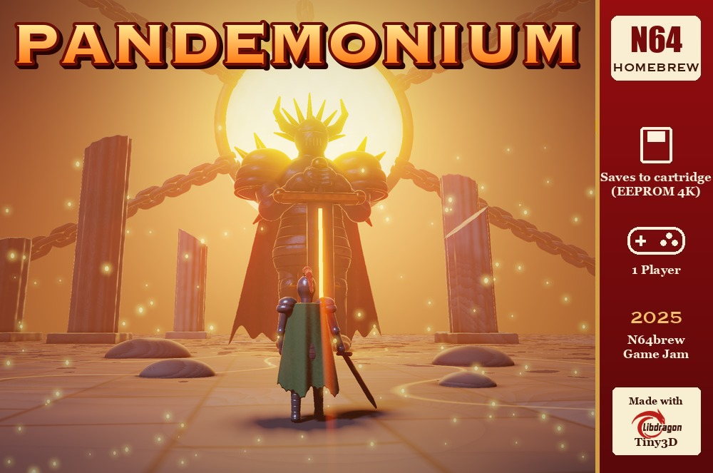
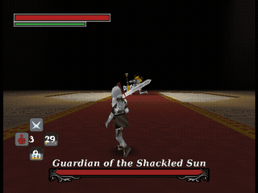
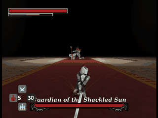
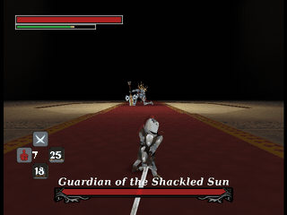
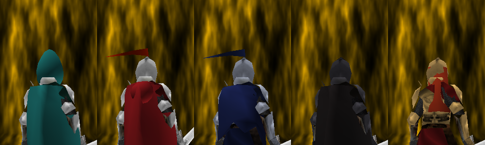
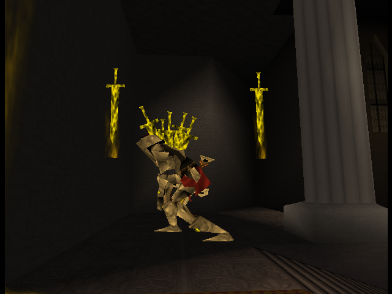
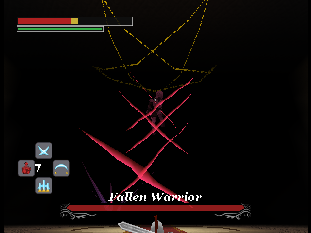
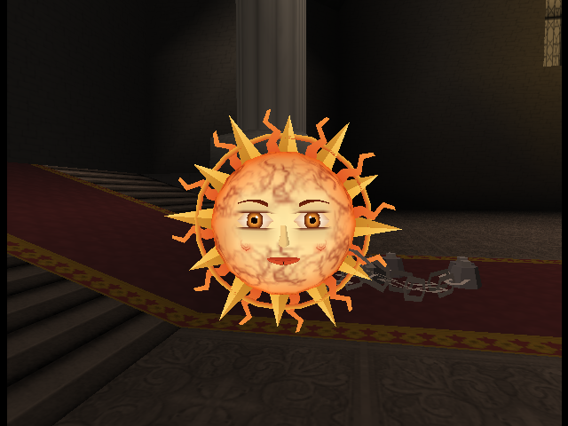
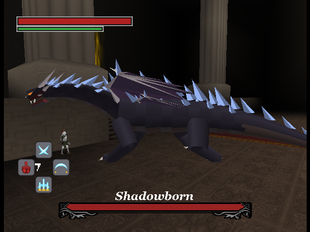

# Pandemonium

## Story
A century long darkness has been cast on the land by the Demon King. The king is guarded by knights, tormented and broken. You are one of them, cast into servitude, forced to bend to the king's will. Pandemonium is an original dark-fantasy souls game inspired by Elden Ring.

## Controls
Stick: Move

A button: Dodge

B button: Attack

C-Pad: Look

D-Pad: Skills (Up / Right / Down) and health potion (Left)

Start button: Pause Menu

Z trigger: Toggle z targetting

Hold Z trigger + left/right on Cpad: Change z target

## New in this fork
**Download:** [Releases](https://github.com/cbyeh/Pandemonium/releases). `Pandemonium.z64` for hardware and accurate emulators (Ares, flashcarts), `The.Pandemonium.z64` for Delta and Mupen64Plus.

### Skills (D-pad)
Toggle in **Settings > Skills** (title screen). In the Tower the setting doesn't apply: skills are learned during the climb.

| Moon Blade Dance (D-Up) | Halfmoon Slash (D-Right) | Crescent Cleave (D-Down) |
|---|---|---|
|  |  |  |

### Skins
**Settings > Skin** lists every skin: the Knight, the Umber Cloak, Wolf Knight, Black Swordsman and Scarlet Valkyrie from the start. Three more unlock:
- **Crimson Cloak:** beat the story and all three Bonus bosses.
- **Teal Cloak:** reach floor 10 of the Tower (two full circles).
- **Nightfarer:** buy him at **Tower > Shrine** for 450 Embers.

### The Tower
**Title > Tower > Climb**: a boss rush, floor after floor with no cutscenes.
- **Circles:** each one is five floors. The Guardian comes first, then the three Bonus bosses in a random order, and Guardian Unbound last.
- **Difficulty:** the climb starts well below the story fights, and the bosses grow stronger every circle.
- **Your start:** you begin as the original game did, with 3 potions and the sword only.
- **Between floors:** a beaten boss gives a potion back (no health), and you choose one of three cards, or Skip for 5 Embers. The first is a skill card while any are left: learn a D-pad skill, or upgrade one you've learned.
- **Pacts:** now and then a card is a Pact, a blessing with a curse that stacks without limit; once the boons run out, every card is one.
- **Boons** come in Common, Rare and Legendary (bronze, blue and gold cards). Legendaries get likelier every circle. Some change how you play: Phantom Step and Riposte reward perfect dodges, Crushing Blows and Executioner reward staggers, Storm Blade calls lightning on every fourth hit, Blood Pact trades potion strength for damage.
- **Nights:** from the second circle, each circle draws a night: Blood Moon, Iron Night or Starfall. Each is a trade-off that pays more Embers, announced before the circle starts.
- **Relics:** buy them at **Tower > Shrine > Relics** (200 Embers each) and equip one to carry into the climb.
- **Embers:** cleared floors earn Embers, kept when you die. Spend them at **Tower > Shrine** on permanent upgrades, which only apply in the Tower, and on the Nightfarer skin.

Each save slot keeps its best floor, Embers, relics, skin and settings (a fresh cart uses Save 1). **Load Game** switches to a slot without starting a fight, and the game reopens on the slot used last. It shows a slot's progress: story clear time, best Tower floor, Bonus bosses beaten and skins earned (of the three that unlock).

### Combat
- **Hit-stop:** sword hits land with a short freeze; the third hit of a combo lands heaviest.
- **Perfect dodge:** roll just as a blow lands for a moment of slow motion and stamina back.
- **Stagger:** land blows to break a boss's stance: the thin gold line under its health. About ten to fourteen sword hits fill it, depending on the boss; a combo's third hit and the skills count for more (Halfmoon Slash about a third), and it keeps through a dodge or two before draining. Breaking it freezes the moment, then slows time briefly, and the boss stays down for 3.5 s: your opening.

### Settings
- **Controls:** three button layouts (Classic, A/B Swapped, Skills on C) and camera speed 1-5. The Controls page shows what each button does.

### New boss fights
Guardian Unbound (the Guardian's second form), plus three **Bonus** fights on the title screen.

| Guardian Unbound | Fallen Warrior (Bonus) | The Shackled Sun (Bonus) | Shadowborne (Bonus) |
|---|---|---|---|
|  |  |  |  |

The ending now plays live in the engine.

## 2025 N64brew Game Jam - Pandemonium
- December 1st - February 1st
- Theme Announced on December 8th
- Theme: Repair (or synonym)
- We are going for a fully fleshed out boss battle. Aesthetic and mechanics of Elden Ring. Weaving in the theme of repair into the boss. 

## Features:
- Souls-Like Boss AI with many different attacks and animations.
- A character controller with many different animation states, with lock-on mechanism.
- A weapon collision system that can use a mix of different types of colliders.
- A real-time cinematic cutscene.
- Uses 32 bit framebuffer for cleaner graphics.
- A distance-based SFX system.
- Weapon streaks & a few different feedback systems.
- Dialog system.
- Almost entirely 64x64 textures with vertex colors for higher res.
- Assets & Music from scratch for the jam. (or heavily modified)
- Scrolling textures on a skinned mesh.

## Jam Game Requirements (simplified version)
- 1 project submission only
- Must work on PAL/NTSC system. Optionally tested on emulator
- Max 5 members to a team
- Any N64 SDK is allowed (libultra/librdragon/etc)
- Game source must be open source in perpetuity
- Game code must mostly be from the team
- Third party assets allowed but must provide credit
- Must be playable, no visual or audio demos

## Screenshots

## Build
- Install libdragon (preview)
- Install Tiny3D (main)
- run make file

### Emulator build (Delta, Mupen64Plus HLE)
`make HLE=1` builds `pandemonium-hle.z64`, which replaces the RSP microcode with CPU code (`hle/`) for high-level-emulation emulators. Needs `ffmpeg`. Not for real hardware or accurate emulators.

### Scripted test runs
The `hle/autoplay.c` scripts (`HLE_TEST_*`) drive the game for automated checks. In the emulator build, pass them as `HLE_EXTRA_CFLAGS="-DHLE_AUTOPLAY -DHLE_TEST_..."`. For the hardware ROM in an accurate emulator such as Ares, pass `TEST_CFLAGS` the same way. The hardware path is where real-RDP behaviour shows: additive blending wraps on overflow there, but HLE renderers clamp it.

## SummerCart64

Deploy to a [SummerCart64](https://github.com/Polprzewodnikowy/SummerCart64) over USB using [sc64deployer](https://github.com/Polprzewodnikowy/SummerCart64/releases). Connect the cart in developer / USB upload mode so `sc64deployer list` succeeds.

**Makefile (builds `pandemonium.z64` first, then uploads):**

- `make deploy` — direct ROM upload to the cart (EEPROM4K save type; optional `--save` via env below).
- `make upload-sd` — copy `pandemonium.z64` to the microSD path `Games/Homebrew/Pandemonium.z64` (override with `SC64_SD_DEST`).
- `make sc64-bootloader` — run `sc64deployer reset` so the cart returns to normal bootloader / power-up behavior.

**Scripts (same behavior; use `--no-build` if you already have `pandemonium.z64`):**

- `./scripts/deploy.sh` — build + deploy, or `./scripts/deploy.sh --no-build`
- `./scripts/upload-sd.sh` — build + SD copy, or `./scripts/upload-sd.sh --no-build`
- `./scripts/upload-sd.sh --reset-first` — if the SD is locked by the N64, reset first then upload (also resets cart config)
- `./scripts/sc64-bootloader.sh` — reset only (equivalent to `make sc64-bootloader`)

**Environment:**

- `SC64_DEPLOYER` — path to the `sc64deployer` binary, or to the extracted release folder containing it (otherwise `sc64deployer` on `PATH`).
- `SC64_SAVE` — if set, passed to deploy as `--save` (preserve EEPROM across uploads), e.g. `SC64_SAVE=./pandemonium.eep`.
- `SC64_EXTRA_ARGS` — extra deployer flags (space-separated), e.g. `SC64_EXTRA_ARGS="--direct"`.
- `SC64_SD_DEST` — destination path on SD for `upload-sd` (default: `Games/Homebrew/Pandemonium.z64`).

## Creating a release (GitHub)
- **Version**: `VERSION` holds it (1.0); the tag is `v$(cat VERSION)`.
- **Build both ROMs** (name the target: a plain `make` can leave an old ROM behind):
  - `make pandemonium.z64` (hardware, accurate emulators)
  - `make pandemonium-hle.z64 HLE=1` (Delta, Mupen64Plus)
- **Publish**: attach them as `Pandemonium.z64` and `The Pandemonium.z64`, e.g. `gh release create v1.0 Pandemonium.z64 "The Pandemonium.z64"`.

## Team Members 
BoxingBruin:
- Github: BoxingBruin
- Discord: BoxingBruin
- Bluesky: boxingbruin.bsky.social

HelloNewman:
- Github: HellooooNewman
- Discord: HelloNewman

Aethrone

### Credits
Third-party audio added in this fork. Everything here is CC0 (public domain), so no attribution is required, but it's given anyway.

| Asset | Used for | Author | Source |
|---|---|---|---|
| CC0 Deep Monster Roar | Shadowborne's roar | trazzz123 | [OpenGameArt](https://opengameart.org/content/cc0-deep-monster-roar) |
| Erase / Escape | The roll | Fupi | [OpenGameArt](https://opengameart.org/content/erase-escape) |
| 80 CC0 RPG SFX | Skill casts, potion, fire breath, the dark beam and nova, explosions, chains, the armour clank | rubberduck | [OpenGameArt](https://opengameart.org/content/80-cc0-rpg-sfx) |
| Determined Pursuit (epic orchestra loop) | Shadowborne's theme | Emma_MA | [OpenGameArt](https://opengameart.org/content/determined-pursuit-epic-orchestra-loop) |
| Boss Battle #2 [Symphonic Metal] | The Shackled Sun's theme | nene | [OpenGameArt](https://opengameart.org/content/boss-battle-2-symphonic-metal) |
| Battle Theme A | The Fallen Warrior's theme | cynicmusic | [OpenGameArt](https://opengameart.org/content/battle-theme-a) |

## Licensing

- Code is licensed under GPLv3. See LICENSE.
- For all non-code assets, including images, music & 3D models. See LICENSE_ASSETS.
