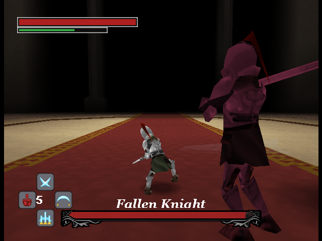
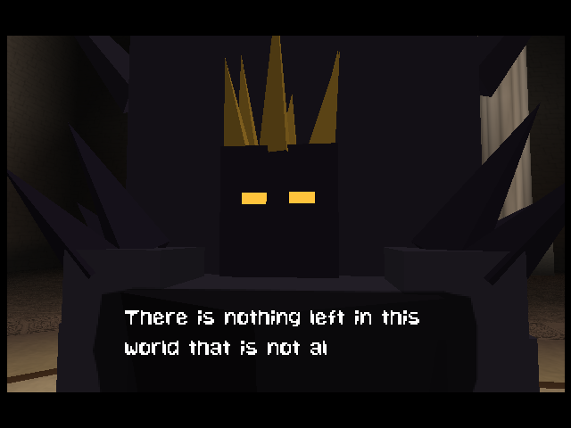

# Pandemonium

## Story
A century long darkness has been cast on the land by the Demon King. The king is guarded by knights, tormented and broken. You are one of them, cast into setvitude, forced to bend to the kings will. Pandemonium is an original dark-fantasy souls game inspired by Elden Ring.

## Controls
Stick: Move

A button: Dodge

B button: Attack

C-Pad: Look

D-Pad: Skills (Up / Right / Down) and health potion (Left)

Start button: Pause Menu

Z trigger: Toggle z targetting

Hold Z trigger + left/right on Cpad: Change z target

## New in this fork

### Skills (D-pad)
Optional sword skills inspired by Dragon Nest's Sword Master, on the D-pad with cooldowns shown on the HUD. Turn them on or off from **Settings > Skills** on the title screen (on by default). With skills on, bosses have double health and you carry 5 potions instead of 3.

| Moon Blade Dance (D-Up) | Halfmoon Slash (D-Right) | Crescent Cleave (D-Down) |
|---|---|---|
|  |  |  |
| Leap high in the direction you are moving (in place when standing still) and rain five X-shaped sword waves on the target, one per swing. Without lock-on they land where the camera looks. | High risk nuke: a long rooted charge (a hit cancels it and hurts more), then a huge 180-degree slash that rolls outward as a wave. | Medium risk: crouch, then a rising swing that raises five light blades in a fan that surge outward, each hitting repeatedly. |

### New boss fights
Defeating the Guardian of the Shackled Sun is no longer the end: it rises again as Guardian Unbound. Two Bonus fights, picked from **Bonus** on the title screen, each have their own intro and ending cutscenes.

| Guardian Unbound | Fallen Knight (Bonus) |
|---|---|
|  |  |
| The Guardian rises again, corrupted: a fresh health bar, an aerial sword barrage and ground sweeps. | A dark, larger mirror of the knight that combos, rolls away from your swings and turns your own skills against you. |

| The Shackled Sun (Bonus) | The ending, rendered live |
|---|---|
|  |  |
| The chained sun itself, a floating eye: it glares crossed waves, rains pillars of light, sweeps a ring of fire you must roll through, and dives onto you (then rests, open to attack). At half health it breaks its shackles and burns hotter and faster. | The ending used to be a pre-rendered video. It now plays in the engine: the King on his throne of gold, the Shackled Sun, and the fall through the vortex (the ROMs are 1-4.6 MB smaller). |

The animations for Crescent Cleave and Halfmoon Slash are spliced from existing knight clips by `tools/compose_anims.py` (rerun it after re-exporting `knight.glb`).

## 2025 N64brew Game Jam - Pandemonium
- December 1st - Feburary 1st
- Theme Annonced on December 8th
- Theme: Repair (or synonym)
- We are going for a fully fleshed out boss battle. Aesthetic and mechanics of Elden Ring. Weaving in the theme of repair into the boss. 

## Features:
- Souls-Like Boss AI with many different attacks and animations.
- A character controller with many different animation states, with lock-on mechanism.
- A weapon collision system that can use a mix of different types of colliders.
- A real-time cinematic cutscene.
- Another cutscene that plays as a video.
- Uses 32 bit framebuffer for cleaner graphics.
- A distance-based SFX system.
- Weapon streaks & a few different feedback systems.
- Dialog system.
- Almost entirely 64x64 textures with vertex colors for higher res.
- Assets & Music from scratch for the jam. (or heavily modified)
- Scrolling textures on a skinned mesh.

## Jam Gam Requirements (simplified version)
- 1 project submission only
- Must work on PAL/NTSC system. Optionally tested on emulator
- Max 5 members to a team
- Any N64 SDK is allowed (libultra/librdragon/etc)
- Game source must be open source in perpetuity
- Game code must mostly be from the team
- Third party assets allowed but must provide credit
- Must be playable, no visual or audio demos

## Screenshots

## Build
- Install libdragon (preview)
- Install Tiny3D (main)
- run make file

### Emulator build (Delta, Mupen64Plus HLE)
`make HLE=1` builds `pandemonium-hle.z64` for emulators that only emulate the RSP at a high level (Delta on iOS, Mupen64Plus with GLideN64 + rsp-hle). These can't run libdragon's RSP microcode, so this build replaces it with CPU code in `hle/`. Graphics become F3DEX2 display lists that the emulator's graphics plugin draws, audio is mixed on the CPU, and the intro video is re-encoded to a CPU-decodable format.

- Needs `ffmpeg` on the PATH (to re-encode the video).
- `hle/` is tied to the libdragon preview commit in `hle/internal/LIBDRAGON_COMMIT` and Tiny3D `6f5ac0b`; update it if you update either.
- Not for real hardware or accurate (LLE) emulators: use the normal `make` ROM for those.

## SummerCart64

Deploy to a [SummerCart64](https://github.com/Polprzewodnikowy/SummerCart64) over USB using [sc64deployer](https://github.com/Polprzewodnikowy/SummerCart64/releases). Connect the cart in developer / USB upload mode so `sc64deployer list` succeeds.

**Makefile (builds `pandemonium.z64` first, then uploads):**

- `make deploy` — direct ROM upload to the cart (EEPROM4K save type; optional `--save` via env below).
- `make upload-sd` — copy `pandemonium.z64` to the microSD path `Games/Homebrew/Pandemonium.z64` (override with `SC64_SD_DEST`).
- `make sc64-bootloader` — run `sc64deployer reset` so the cart returns to normal bootloader / power-up behavior.

**Scripts (same behavior; use `--no-build` if you already have `pandemonium.z64`):**

- `./scripts/deploy.sh` — build + deploy, or `./scripts/deploy.sh --no-build`
- `./scripts/upload-sd.sh` — build + SD copy, or `./scripts/upload-sd.sh --no-build`
- `./scripts/upload-sd.sh --reset-first` — if the SD is locked by the N64, reset first then upload (also resets cart config)
- `./scripts/sc64-bootloader.sh` — reset only (equivalent to `make sc64-bootloader`)

**Environment:**

- `SC64_DEPLOYER` — path to the `sc64deployer` binary, or to the extracted release folder containing it (otherwise `sc64deployer` on `PATH`).
- `SC64_SAVE` — if set, passed to deploy as `--save` (preserve EEPROM across uploads), e.g. `SC64_SAVE=./pandemonium.eep`.
- `SC64_EXTRA_ARGS` — extra deployer flags (space-separated), e.g. `SC64_EXTRA_ARGS="--direct"`.
- `SC64_SD_DEST` — destination path on SD for `upload-sd` (default: `Games/Homebrew/Pandemonium.z64`).

## Creating a release (GitHub)
- **Bump version**: update `VERSION`, commit, and push.
- **Build the versioned ROM**:
  - `make clean && make versioned`
  - Produces: `Pandemonium-$(cat VERSION).z64`
- **Tag the release**:
  - `git tag -a "v$(cat VERSION)" -m "v$(cat VERSION)"`
  - `git push && git push --tags`
- **Publish on GitHub**: GitHub → *Releases* → *Draft a new release* → select tag `vX.Y.Z` → attach `Pandemonium-X.Y.Z.z64` → *Publish release*.

## Team Members 
BoxingBruin:
- Github: BoxingBruin
- Discord: BoxingBruin
- Bluesky: boxingbruin.bsky.social

HelloNewman:
- Github: HellooooNewman
- Discord: HelloNewman

## Licensing

- Code is licensed under GPLv3. See LICENSE.
- For all non-code assets, including images, music & 3D models. See LICENSE_ASSETS.
